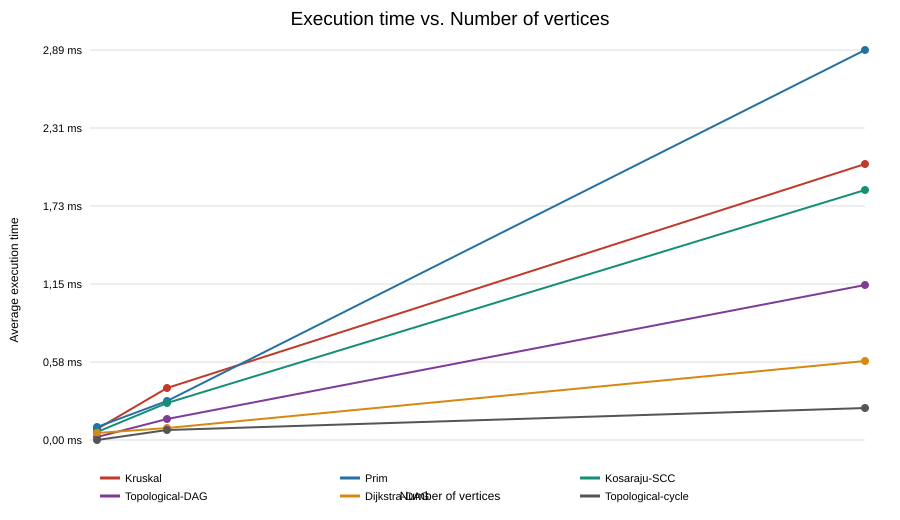

# Assignment 3 — Smart City Infrastructure and Route Planning

## Overview

This Java application models a smart city as a weighted graph. Vertices represent city districts or locations, while edges represent roads or infrastructure connections. Edge weights represent distance or construction cost. The application implements minimum spanning tree algorithms, connectivity algorithms, shortest-path search, reproducible graph generation, correctness checks, and benchmarking.

## Project Structure

```text
ASSIGNMENT3 DAA/
├── src/
│   ├── Main.java
│   ├── graph/
│   │   ├── Edge.java
│   │   └── Graph.java
│   ├── dsu/DSU.java
│   ├── mst/
│   │   ├── Kruskal.java
│   │   ├── Prim.java
│   │   └── MSTResult.java
│   ├── connectivity/
│   │   ├── TopologicalSort.java
│   │   └── SCC.java
│   ├── shortestpath/Dijkstra.java
│   ├── experiments/
│   │   ├── Benchmark.java
│   │   ├── GraphGenerator.java
│   │   └── PlotGenerator.java
│   └── tests/AlgorithmTests.java
├── results/
│   ├── tables/benchmark_results.csv
│   └── plots/
│       ├── time_vs_vertices.svg
│       └── time_vs_edges.svg
└── README.md
```

## Implementation

- **Kruskal:** Sorts edges by weight and uses Disjoint Set Union (DSU) to avoid cycles.
- **Prim:** Grows a minimum spanning tree using a priority queue.
- **DSU:** Uses path compression and union by rank; it also records find, union, and parent-hop counts.
- **Topological ordering:** Uses Kahn's algorithm. It returns an ordering for a DAG and reports a cycle when no ordering exists.
- **Strongly connected components:** Uses Kosaraju's two-pass depth-first search.
- **Dijkstra:** Uses a priority queue to find shortest paths from a source. The graph rejects negative edge weights.
- **Benchmark:** Runs each algorithm five measured times after two warm-up runs. It saves average execution time and operation counts as CSV.
- **PlotGenerator:** Reads the CSV and creates SVG charts for execution time versus vertex count and edge count.

## Complexity Analysis

Let V be the number of vertices and E the number of edges. The graph uses adjacency lists; Prim and Dijkstra use binary heaps.

| Algorithm | Time complexity | Additional space |
|---|---:|---:|
| DSU `find` and `union` | Amortized O(α(V)) per operation | O(V) |
| Kruskal | O(E log E) | O(V + E) |
| Prim | O((V + E) log V) | O(V + E) |
| Kosaraju SCC | O(V + E) | O(V + E) |
| Topological ordering | O(V + E) | O(V) |
| Dijkstra | O((V + E) log V) | O(V + E) |

Path compression shortens DSU parent paths, while union by rank keeps the trees shallow. Together they make DSU operations nearly constant time in practice. Kruskal's runtime is mainly affected by sorting edges. Prim processes the frontier of the growing tree. SCC and topological ordering visit each vertex and edge a constant number of times. Dijkstra processes reachable vertices and outgoing edges.

Dijkstra is unsuitable for graphs with negative edge weights because a distance that has already been finalized may later be improved through a negative edge.

## Experimental Setup

The benchmark uses these graph configurations:

| Size | Vertices (V) | Edges (E) |
|---|---:|---:|
| Small | 10 | 30 |
| Medium | 100 | 500 |
| Large | 1,000 | 5,000 |

A fixed seed (`20260317`) and derived seeds make graph generation reproducible. Undirected graphs are connected by first generating a spanning tree, then adding unique edges. DAGs use forward-only edges from lower-numbered to higher-numbered vertices. Cyclic graphs add a return edge from the final vertex to vertex 0.

The benchmark uses `System.nanoTime()`, performs five measured repetitions after two warm-up calls, and records average runtime and algorithm-specific operation counts. Runtime measurements depend on the computer and Java runtime.

## Results

The benchmark writes the measurements to [`results/tables/benchmark_results.csv`](results/tables/benchmark_results.csv). The file includes graph size, algorithm, average runtime in nanoseconds, and average operation count. Run the benchmark to populate it with measurements from your computer.

### Execution Time vs. Number of Vertices



### Execution Time vs. Number of Edges


Both MST algorithms should return the same weight on each connected undirected graph. Kruskal sorts edges, while Prim expands the tree using a priority queue. SCC and topological ordering should grow approximately with V + E. Dijkstra's measured work depends on which vertices are reachable from its source.

## Testing

The built-in tests cover:

- Matching Kruskal and Prim MST weights, including duplicate edge weights.
- Disconnected graphs and a graph with one vertex.
- Topological ordering validity and directed cycle detection.
- SCC partition coverage, with each vertex appearing exactly once.
- Dijkstra distances, paths, and unreachable vertices.
- Connected, acyclic, and cyclic graph generation.

## Running the Project

From the project directory, compile the source files:

```bash
javac -d build $(find src -name '*.java')
```

Run the correctness checks:

```bash
java -cp build Main --test
```

Run the benchmark and generate its CSV table and plots:

```bash
java -cp build Main --benchmark
```

## Conclusion

Kruskal and Prim are suitable for finding a minimum-cost network that connects all districts. DSU supports efficient cycle checks in Kruskal's algorithm. Topological ordering is useful for planning dependencies in a DAG, while SCC groups mutually reachable locations. Dijkstra is appropriate for shortest-path planning when all edge weights are non-negative.
